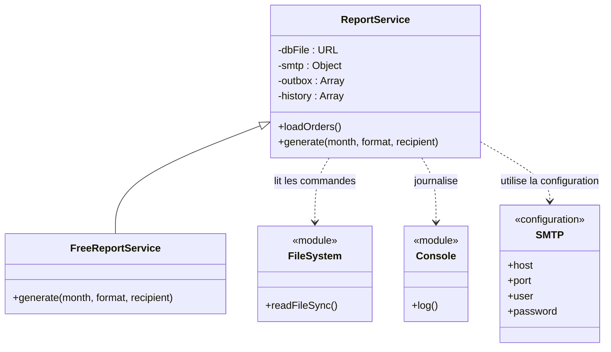

# Diagrammes d'architecture

## 1. Architecture actuelle — avant refactoring

Dans l'architecture initiale, `ReportService` cumule plusieurs responsabilités :

- Lecture des commandes depuis le fichier `orders.json` ;
- Calcul des indicateurs métier : chiffre d'affaires HT, TVA, chiffre d'affaires TTC, panier moyen et ventilation par catégorie ;
- Génération des rapports aux formats CSV, HTML et JSON ;
- Journalisation des rapports ;
- Préparation des informations d'envoi des e-mails.

Cette concentration des responsabilités rend la classe plus difficile à tester, à maintenir et à faire évoluer.

La classe `FreeReportService` hérite de `ReportService`, mais limite les fonctionnalités accessibles aux comptes gratuits.

## 2. Architecture cible — après refactoring complet

Le diagramme suivant représente une architecture cible dans laquelle les responsabilités sont séparées. Il décrit une évolution souhaitée du système : toutes les classes et interfaces présentées ne sont pas encore implémentées dans notre code.

```mermaid
classDiagram
    class ReportService {
        +generate(month, format, recipient)
    }

    class OrdersRepository {
        <<interface>>
        +loadOrders()
    }

    class FileOrdersRepository {
        +loadOrders()
    }

    class StatisticsCalculator {
        <<interface>>
        +calculate(orders, month)
    }

    class SalesStatisticsCalculator {
        +calculate(orders, month)
    }

    class ReportFormatter {
        <<interface>>
        +format(stats)
    }

    class CsvFormatter {
        +format(stats)
    }

    class HtmlFormatter {
        +format(stats)
    }

    class JsonFormatter {
        +format(stats)
    }

    class Logger {
        <<interface>>
        +log(message)
    }

    class ConsoleLogger {
        +log(message)
    }

    class Mailer {
        <<interface>>
        +send(recipient, subject, body)
    }

    class SmtpMailer {
        +send(recipient, subject, body)
    }

    class FreeReportService {
        +generate(month, format, recipient)
    }

    ReportService --> OrdersRepository : dépend de
    ReportService --> StatisticsCalculator : dépend de
    ReportService --> ReportFormatter : dépend de
    ReportService --> Logger : dépend de
    ReportService --> Mailer : dépend de

    FileOrdersRepository ..|> OrdersRepository : implémente
    SalesStatisticsCalculator ..|> StatisticsCalculator : implémente
    CsvFormatter ..|> ReportFormatter : implémente
    HtmlFormatter ..|> ReportFormatter : implémente
    JsonFormatter ..|> ReportFormatter : implémente
    ConsoleLogger ..|> Logger : implémente
    SmtpMailer ..|> Mailer : implémente

    ReportService <|-- FreeReportService
```

Cette architecture cible propose une séparation des responsabilités :

- `OrdersRepository` définit l'accès aux commandes ;
- `StatisticsCalculator` définit le calcul des indicateurs métier ;
- `ReportFormatter` définit une interface commune pour les différents formats de rapport ;
- `CsvFormatter`, `HtmlFormatter` et `JsonFormatter` assurent chacun le formatage d'un rapport ;
- `Logger` définit la journalisation ;
- `Mailer` définit l'envoi des e-mails.

Les classes `FileOrdersRepository`, `SalesStatisticsCalculator`, `ConsoleLogger` et `SmtpMailer` représentent des implémentations concrètes de leurs interfaces respectives.

Dans cette architecture cible, `ReportService` dépend des interfaces plutôt que directement des implémentations techniques. Cela facilite les tests et permet de remplacer une implémentation sans modifier la logique principale du service.

L'interface commune `ReportFormatter` permet également d'ajouter un nouveau format de rapport sans concentrer tous les formats dans une seule classe.

**Remarque :** ce diagramme représente une cible théorique après refactoring complet. Les abstractions supplémentaires sont des propositions d'évolution et ne sont pas toutes implémentées dans notre code actuel.

## 3. Refactoring réellement réalisé

Dans le cadre du TP, nous avons extrait la responsabilité du formatage CSV dans une classe distincte `CsvFormatter`, placée dans son propre fichier `CsvFormatter.js`.

La classe `ReportService` reçoit ce formateur par injection de dépendances dans son constructeur. Si aucun formateur n'est fourni, une instance de `CsvFormatter` est utilisée par défaut.

Cette injection permet de remplacer le formateur CSV par un faux objet pendant les tests, afin de vérifier que `ReportService` utilise bien la dépendance qui lui est fournie.

Les responsabilités suivantes restent actuellement dans `ReportService` :

- Lecture des commandes depuis `orders.json` ;
- Calcul des indicateurs métier ;
- Génération des rapports HTML et JSON ;
- Journalisation ;
- Préparation des informations d'envoi des e-mails.

Les autres abstractions présentées dans le diagramme cible constituent des pistes d'amélioration qui pourraient être implémentées dans un refactoring plus complet.